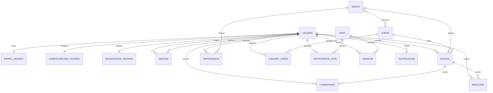

# GameLoop — Red social de videojuegos

**Asignatura:** Desarrollo Web en Entorno Servidor (DWES)  
**Proyecto:** Aplicación web — Inicio y modelos  
**Autores:** Alejandro Fernández Linares y José Manuel Fernández Linares  
**Repositorio GitHub:** https://github.com/CLASEJMFL/Proyecto_2_DAW

---

## Índice

1. Descripción de la aplicación web
2. Repositorio Git y preparación del proyecto Django
3. Modelos de la aplicación
4. Relaciones entre los modelos
5. Tipos de campos y parámetros utilizados
6. Diagrama entidad-relación
7. Seeders y generación de datos con Faker
8. Copias de seguridad mediante fixtures
9. Comprobación de los requisitos
10. Explicación del código utilizado
11. Archivos que no deben subirse a Git
12. Conclusión

---

## 1. Descripción de la aplicación web

### 1.1. ¿En qué consiste GameLoop?

GameLoop es una aplicación web desarrollada con Django que funciona como una comunidad de usuarios interesados en los videojuegos.

La aplicación permite que los usuarios tengan un perfil personal, configuren sus preferencias, registren sus videojuegos favoritos, establezcan amistades con otros usuarios, participen en grupos, consulten noticias, publiquen comentarios, reaccionen a las noticias, participen en chats y reciban notificaciones.

La aplicación está diseñada para organizar toda esta información mediante una base de datos relacional. Para ello, se utilizan modelos de Django que representan las distintas entidades y relaciones de la plataforma.

Además, el proyecto incorpora la generación de datos ficticios con Faker, la administración de los registros mediante Django Admin y la exportación e importación de datos mediante fixtures.

La idea del proyecto también contempla la posibilidad de publicar contenido en redes sociales externas. Esta funcionalidad requeriría implementar las integraciones correspondientes con las API oficiales y los permisos necesarios.

### 1.2. Objetivos del proyecto

Los objetivos principales son:

- Desarrollar una aplicación utilizando Django y Python.
- Diseñar una base de datos relacional.
- Crear modelos con diferentes tipos de campos.
- Implementar relaciones uno a uno, uno a muchos y muchos a muchos.
- Utilizar tablas intermedias con atributos adicionales.
- Generar datos de prueba mediante un comando personalizado y Faker.
- Crear copias de seguridad mediante fixtures.
- Documentar el código y los modelos.
- Utilizar Git y GitHub para gestionar el proyecto.

## 2. Repositorio Git y preparación del proyecto Django

### 2.1. Repositorio

El proyecto está alojado en GitHub:

https://github.com/CLASEJMFL/Proyecto_2_DAW

Git permite controlar las modificaciones realizadas en el código, recuperar versiones anteriores y trabajar con distintas ramas.

El enunciado exige disponer de estas tres ramas:

- `Configuracion_inicial`: preparación inicial del proyecto Django.
- `Modelos`: desarrollo de los modelos y las relaciones de la base de datos.
- `Backups`: trabajo relacionado con los datos de prueba y las copias de seguridad.

Para consultar las ramas disponibles se utiliza:

```bash
git branch -a
```

La existencia de las tres ramas debe comprobarse en el repositorio. No basta con que aparezcan mencionadas en este documento.

### 2.2. Tecnologías utilizadas

- **Python:** lenguaje de programación utilizado para desarrollar la aplicación.
- **Django:** framework utilizado para organizar el proyecto y gestionar los modelos.
- **SQLite:** base de datos configurada por defecto en el proyecto.
- **Django ORM:** sistema que permite trabajar con la base de datos mediante objetos Python.
- **Faker:** biblioteca utilizada para generar datos ficticios.
- **Git:** sistema de control de versiones.
- **GitHub:** plataforma de alojamiento del repositorio.

### 2.3. Estructura del proyecto

La estructura principal es la siguiente:

```text
Proyecto_2_DAW/
├── GameLoop/
│   ├── __init__.py
│   ├── settings.py
│   ├── urls.py
│   ├── asgi.py
│   └── wsgi.py
├── core/
│   ├── __init__.py
│   ├── admin.py
│   ├── apps.py
│   ├── models.py
│   ├── tests.py
│   ├── migrations/
│   └── management/
│       └── commands/
│           └── seed.py
├── manage.py
├── requirements.txt
├── backup.json
└── README.md
```

Los archivos principales son:

- `settings.py`: contiene la configuración general del proyecto Django.
- `urls.py`: contiene la configuración de las rutas.
- `models.py`: define los modelos de la base de datos.
- `admin.py`: registra los modelos que se gestionan desde el administrador.
- `migrations/`: contiene los cambios de estructura de la base de datos.
- `seed.py`: contiene el comando personalizado para generar datos de prueba.
- `manage.py`: permite ejecutar los comandos de administración de Django.
- `requirements.txt`: contiene las dependencias del proyecto.
- `backup.json`: contiene la exportación de datos mediante fixtures.

### 2.4. Instalación y ejecución

Para descargar el proyecto:

```bash
git clone https://github.com/CLASEJMFL/Proyecto_2_DAW.git
cd Proyecto_2_DAW
```

Para crear un entorno virtual en Windows:

```powershell
py -m venv .venv
.\.venv\Scripts\Activate.ps1
```

Para instalar las dependencias:

```bash
pip install -r requirements.txt
pip install Faker
```

La biblioteca Faker debe estar incluida también en `requirements.txt` para que la instalación del proyecto sea reproducible.

Para aplicar las migraciones:

```bash
python manage.py migrate
```

Para crear un superusuario:

```bash
python manage.py createsuperuser
```

Para iniciar el servidor de desarrollo:

```bash
python manage.py runserver
```

El servidor estará disponible normalmente en `http://127.0.0.1:8000/` y el panel de administración en `http://127.0.0.1:8000/admin/`.

---

## 3. Modelos de la aplicación

Los modelos se encuentran en `core/models.py`. Cada modelo representa una entidad de la aplicación y define los campos que permiten almacenar sus datos.

El proyecto contiene **16 modelos definidos**. El modelo `Usuario` hereda de `AbstractUser`, por lo que también dispone de los campos de autenticación que proporciona Django.

Los campos de relación se explican en sus respectivos apartados. Cuando un campo tiene un parámetro especial, se indica su función.

### 3.1. Usuario

Representa a los usuarios registrados en GameLoop.

Hereda de `AbstractUser`, una clase de Django que proporciona campos y funcionalidades de autenticación.

Campos propios:

- `foto_perfil`: campo `URLField` que almacena la dirección web de la imagen del perfil. Utiliza `blank=True`.
- `biografia`: campo `TextField` que almacena la descripción personal. Utiliza `blank=True`.
- `fecha_registro`: campo `DateTimeField` que guarda automáticamente la fecha y hora de creación mediante `auto_now_add=True`.

El método `__str__` devuelve el nombre de usuario, lo que facilita su identificación en el administrador.

Además, hereda campos como `username`, `password`, `first_name`, `last_name` y `email` de Django.

### 3.2. PerfilUsuario

Almacena información adicional sobre el perfil de cada usuario.

- `usuario`: `OneToOneField` que relaciona el perfil con un usuario. Utiliza `on_delete=models.CASCADE` y `related_name="perfil"`.
- `nombre_visible`: `CharField` con una longitud máxima de 100 caracteres. Utiliza `blank=True`.
- `biografia`: `TextField` que permite almacenar una descripción y utiliza `blank=True`.
- `fecha_nacimiento`: `DateField` que almacena la fecha de nacimiento. Utiliza `null=True` y `blank=True`.
- `web`: `URLField` que almacena la página personal y utiliza `blank=True`.

Cada usuario puede tener como máximo un perfil asociado.

### 3.3. ConfiguracionUsuario

Almacena las preferencias de configuración de cada usuario.

- `usuario`: `OneToOneField` que relaciona la configuración con un usuario. Utiliza `on_delete=models.CASCADE` y `related_name="configuracion"`.
- `tema_oscuro`: `BooleanField` que indica si está activado el tema oscuro. Tiene `default=False`.
- `notificaciones_activadas`: `BooleanField` que indica si están activadas las notificaciones. Tiene `default=True`.
- `idioma`: `CharField` con una longitud máxima de 10 caracteres y `default="es"`.

Este modelo permite mantener las preferencias separadas de los datos generales de la cuenta.

### 3.4. EstadisticasUsuario

Almacena estadísticas relacionadas con la actividad de un usuario.

- `usuario`: `OneToOneField` que relaciona las estadísticas con un usuario. Utiliza `on_delete=models.CASCADE` y `related_name="estadisticas"`.
- `juegos_favoritos`: `PositiveIntegerField` que almacena el número de juegos favoritos. Tiene `default=0`.
- `horas_totales`: `FloatField` que almacena las horas totales jugadas. Tiene `default=0`.
- `nivel`: `PositiveSmallIntegerField` que almacena el nivel del usuario. Tiene `default=1`.
- `puntuacion_media`: `DecimalField` que almacena una puntuación con cuatro dígitos como máximo y dos decimales. Utiliza `max_digits=4`, `decimal_places=2` y `default=0`.

### 3.5. Amistad

Representa una solicitud o relación de amistad entre dos usuarios.

- `usuario_origen`: `ForeignKey` que identifica al usuario que envía la solicitud. Utiliza `on_delete=models.CASCADE` y `related_name="amistades_enviadas"`.
- `usuario_destino`: `ForeignKey` que identifica al destinatario. Utiliza `on_delete=models.CASCADE` y `related_name="amistades_recibidas"`.
- `estado`: `CharField` con una longitud máxima de 20 caracteres y `default="pendiente"`.
- `fecha_solicitud`: `DateTimeField` que registra automáticamente la fecha de creación mediante `auto_now_add=True`.
- `fecha_aceptacion`: `DateTimeField` que almacena la fecha de aceptación. Utiliza `null=True` y `blank=True`.

Los dos campos de usuario apuntan al mismo modelo, pero representan funciones diferentes: el origen y el destinatario.

### 3.6. Grupo

Representa un grupo de usuarios que comparten intereses relacionados con videojuegos.

- `nombre`: `CharField` con una longitud máxima de 100 caracteres.
- `descripcion`: `TextField` que permite dejar vacía la descripción mediante `blank=True`.
- `imagen`: `URLField` que almacena la dirección de la imagen y utiliza `blank=True`.
- `fecha_creacion`: `DateTimeField` que registra automáticamente la fecha de creación mediante `auto_now_add=True`.
- `usuarios`: `ManyToManyField` que relaciona los grupos con los usuarios mediante el modelo intermedio `Pertenencia`.
- `juegos`: `ManyToManyField` que relaciona los grupos con videojuegos y utiliza `blank=True`.

Los campos `usuarios` y `juegos` son relaciones y no campos de datos simples.

### 3.7. Pertenencia

Es el modelo intermedio que relaciona usuarios con grupos. Permite almacenar información adicional sobre la participación.

- `usuario`: `ForeignKey` que identifica al usuario.
- `grupo`: `ForeignKey` que identifica al grupo.
- `rol`: `CharField` con una longitud máxima de 30 caracteres y `default="miembro"`.
- `fecha_union`: `DateTimeField` que registra automáticamente la incorporación mediante `auto_now_add=True`.

Este modelo permite registrar si un usuario pertenece a un grupo y qué rol desempeña.

### 3.8. Juego

Representa un videojuego de la aplicación.

- `nombre`: `CharField` con una longitud máxima de 100 caracteres.
- `descripcion`: `TextField` que almacena la descripción y utiliza `blank=True`.
- `genero`: `CharField` con una longitud máxima de 50 caracteres.
- `imagen`: `URLField` que almacena la dirección de la imagen y utiliza `blank=True`.
- `fecha_lanzamiento`: `DateField` que almacena la fecha de lanzamiento. Utiliza `null=True` y `blank=True`.
- `plataformas`: `CharField` con una longitud máxima de 200 caracteres y `blank=True`.

### 3.9. Noticia

Representa una noticia relacionada con un videojuego.

- `titulo`: `CharField` con una longitud máxima de 200 caracteres.
- `contenido`: `TextField` que almacena el contenido de la noticia.
- `fecha_publicacion`: `DateTimeField` que registra automáticamente la fecha de creación mediante `auto_now_add=True`.
- `autor`: `ForeignKey` que identifica al usuario que escribe la noticia.
- `grupo`: `ForeignKey` opcional que relaciona la noticia con un grupo. Utiliza `on_delete=models.CASCADE`, `null=True` y `blank=True`.
- `juego`: `ForeignKey` que relaciona la noticia con un videojuego.

### 3.10. Comentario

Representa un comentario realizado por un usuario en una noticia.

- `contenido`: `TextField` que almacena el texto del comentario.
- `fecha`: `DateTimeField` que registra automáticamente la fecha de creación mediante `auto_now_add=True`.
- `usuario`: `ForeignKey` que identifica al autor del comentario.
- `noticia`: `ForeignKey` que identifica la noticia comentada. Utiliza `on_delete=models.CASCADE` y `related_name="comentarios"`.

El parámetro `related_name` permite acceder a los comentarios de una noticia desde el objeto relacionado.

### 3.11. Reaccion

Representa una reacción de un usuario a una noticia.

- `tipo`: `CharField` con una longitud máxima de 20 caracteres y `choices=TIPO_CHOICES`.
- `fecha`: `DateTimeField` que registra automáticamente la fecha de creación.
- `usuario`: `ForeignKey` que identifica al usuario que realiza la reacción.
- `noticia`: `ForeignKey` que identifica la noticia que recibe la reacción.

Las opciones definidas en `TIPO_CHOICES` son:

- `me_gusta`: Me gusta.
- `no_me_gusta`: No me gusta.

El parámetro `choices` restringe los valores permitidos del campo.

### 3.12. UsuarioJuego

Registra la relación entre un usuario y un videojuego, incluyendo datos sobre su actividad.

- `usuario`: `ForeignKey` que identifica al usuario.
- `juego`: `ForeignKey` que identifica al videojuego.
- `horas_jugadas`: `FloatField` que almacena las horas dedicadas al juego. Tiene `default=0`.
- `favorito`: `BooleanField` que indica si es uno de los juegos favoritos. Tiene `default=False`.
- `fecha_inicio`: `DateField` que almacena la fecha de inicio. Utiliza `null=True` y `blank=True`.

El modelo contiene dos claves foráneas y atributos adicionales sobre la actividad del usuario. Aunque representa una asociación entre usuarios y juegos, actualmente no está configurado como el modelo intermedio explícito de un `ManyToManyField`.

### 3.13. Chat

Representa una conversación entre usuarios.

- `tipo`: `CharField` con una longitud máxima de 10 caracteres y `choices=TIPO_CHOICES`.
- `fecha_creacion`: `DateTimeField` que registra automáticamente la fecha de creación.
- `nombre`: `CharField` con una longitud máxima de 100 caracteres y `blank=True`.
- `participantes`: `ManyToManyField` que relaciona chats y usuarios mediante el modelo intermedio `ParticipanteChat`. Utiliza `related_name="chats"`.

Las opciones de `tipo` son `privado` y `grupal`.

### 3.14. ParticipanteChat

Representa la participación de un usuario en un chat y actúa como modelo intermedio.

- `usuario`: `ForeignKey` que identifica al participante.
- `chat`: `ForeignKey` que identifica la conversación.
- `fecha_union`: `DateTimeField` que registra automáticamente la fecha de incorporación.
- `rol`: `CharField` con una longitud máxima de 30 caracteres y `default="miembro"`.

La tabla intermedia permite guardar el rol y la fecha de incorporación de cada usuario en cada conversación.

### 3.15. Mensaje

Representa un mensaje enviado dentro de un chat.

- `contenido`: `TextField` que almacena el texto del mensaje.
- `fecha_envio`: `DateTimeField` que registra automáticamente la fecha de creación.
- `autor`: `ForeignKey` que identifica al usuario que envía el mensaje.
- `chat`: `ForeignKey` que identifica la conversación en la que se envía.

Cada mensaje pertenece a un autor y a un chat.

### 3.16. Notificacion

Representa una notificación dirigida a un usuario.

- `tipo`: `CharField` con una longitud máxima de 20 caracteres y `choices=TIPO_CHOICES`.
- `mensaje`: `TextField` que almacena el contenido de la notificación.
- `fecha`: `DateTimeField` que registra automáticamente la fecha de creación.
- `usuario`: `ForeignKey` que identifica al destinatario.
- `leida`: `BooleanField` que indica si se ha leído. Tiene `default=False`.

Las opciones de `tipo` son `amistad`, `comentario`, `mensaje` y `grupo`.

---

## 4. Relaciones entre modelos

### 4.1. Relaciones uno a uno (OneToOne)

Una relación uno a uno permite asociar un registro de un modelo con un único registro de otro modelo.

En GameLoop se utilizan tres relaciones:

1. `Usuario` — `PerfilUsuario`.
2. `Usuario` — `ConfiguracionUsuario`.
3. `Usuario` — `EstadisticasUsuario`.

Se implementan mediante `OneToOneField`. El parámetro `on_delete=models.CASCADE` indica que, si se elimina el usuario, también se eliminan sus registros relacionados.

### 4.2. Relaciones muchos a uno (ManyToOne)

Una relación muchos a uno permite que varios registros apunten a un mismo registro de otro modelo. En Django se implementa mediante `ForeignKey`.

Ejemplos:

- `Noticia` → `Usuario`, mediante `autor`.
- `Noticia` → `Juego`, mediante `juego`.
- `Comentario` → `Noticia`, mediante `noticia`.
- `Comentario` → `Usuario`, mediante `usuario`.
- `Reaccion` → `Noticia`, mediante `noticia`.
- `Mensaje` → `Chat`, mediante `chat`.
- `Mensaje` → `Usuario`, mediante `autor`.
- `Notificacion` → `Usuario`, mediante `usuario`.
- `Amistad` → `Usuario`, mediante `usuario_origen` y `usuario_destino`.

### 4.3. Relaciones muchos a muchos (ManyToMany)

Una relación muchos a muchos permite que varios registros de un modelo se relacionen con varios registros del otro modelo.

En GameLoop se utilizan:

- `Grupo.usuarios`: relaciona grupos y usuarios mediante `Pertenencia`.
- `Chat.participantes`: relaciona chats y usuarios mediante `ParticipanteChat`.
- `Grupo.juegos`: relaciona grupos y videojuegos mediante una tabla intermedia automática de Django.

### 4.4. Tablas intermedias con atributos extra

**Pertenencia**

Contiene las claves foráneas `usuario` y `grupo`, además de los campos `rol` y `fecha_union`.

**ParticipanteChat**

Contiene las claves foráneas `usuario` y `chat`, además de los campos `fecha_union` y `rol`.

Estas tablas intermedias permiten almacenar información adicional sobre cada asociación.

---

## 5. Tipos de campos y parámetros utilizados

### 5.1. Tipos de campos de datos

En los modelos se utilizan los siguientes tipos de campos, sin contar los campos de relación:

| Tipo | Descripción | Ejemplo |
|---|---|---|
| `CharField` | Almacena texto corto con longitud máxima. | `nombre` |
| `TextField` | Almacena texto largo. | `contenido` |
| `BooleanField` | Almacena valores verdadero o falso. | `leida` |
| `PositiveIntegerField` | Almacena enteros no negativos. | `juegos_favoritos` |
| `PositiveSmallIntegerField` | Almacena enteros pequeños no negativos. | `nivel` |
| `FloatField` | Almacena números de coma flotante. | `horas_totales` |
| `DecimalField` | Almacena números decimales con precisión definida. | `puntuacion_media` |
| `DateField` | Almacena fechas. | `fecha_nacimiento` |
| `DateTimeField` | Almacena fechas y horas. | `fecha_registro` |
| `URLField` | Almacena direcciones web. | `foto_perfil` |

Los campos `OneToOneField`, `ForeignKey` y `ManyToManyField` son campos de relación y no se cuentan entre los diez tipos de atributos de datos exigidos.

### 5.2. Parámetros de los campos

**`max_length`**

Establece la longitud máxima de un campo de texto.

```python
nombre = models.CharField(max_length=100)
```

En este ejemplo, el campo puede almacenar texto con una longitud máxima de 100 caracteres.

**`blank=True`**

Permite que el campo quede vacío durante la validación de formularios.

```python
biografia = models.TextField(blank=True)
```

**`null=True`**

Permite almacenar un valor `NULL` en la base de datos.

```python
fecha_nacimiento = models.DateField(null=True, blank=True)
```

**`default`**

Define el valor predeterminado de un campo.

```python
tema_oscuro = models.BooleanField(default=False)
```

**`auto_now_add=True`**

Asigna automáticamente la fecha y hora cuando se crea el registro.

```python
fecha_registro = models.DateTimeField(auto_now_add=True)
```

**`on_delete=models.CASCADE`**

Establece que los registros dependientes se eliminen cuando se elimina el objeto relacionado.

```python
usuario = models.ForeignKey(
    Usuario,
    on_delete=models.CASCADE
)
```

**`related_name`**

Define el nombre que se utiliza para acceder a una relación desde el modelo relacionado.

```python
noticia = models.ForeignKey(
    Noticia,
    on_delete=models.CASCADE,
    related_name="comentarios"
)
```

Permite consultar los comentarios de una noticia a través de `noticia.comentarios.all()`.

**`max_digits`**

Establece el número máximo de dígitos de un campo decimal.

**`decimal_places`**

Establece el número de cifras decimales de un campo decimal.

```python
puntuacion_media = models.DecimalField(
    max_digits=4,
    decimal_places=2,
    default=0
)
```

**`choices`**

Define las opciones admitidas por un campo.

```python
TIPO_CHOICES = [
    ("privado", "Privado"),
    ("grupal", "Grupal"),
]
```

**`through`**

Permite indicar el modelo intermedio utilizado en una relación muchos a muchos.

```python
usuarios = models.ManyToManyField(
    Usuario,
    through="Pertenencia",
    related_name="grupos"
)
```

En conjunto, los modelos utilizan más de diez parámetros distintos, entre ellos `max_length`, `blank`, `null`, `default`, `auto_now_add`, `on_delete`, `related_name`, `max_digits`, `decimal_places`, `choices` y `through`.

---

## 6. Diagrama entidad-relación

El siguiente esquema representa los modelos principales y sus relaciones. Está escrito en Mermaid para que GitHub pueda visualizarlo directamente.



El esquema muestra las relaciones entre usuarios, perfiles, configuraciones, estadísticas, amistades, grupos, videojuegos, noticias, comentarios, reacciones, chats, mensajes y notificaciones.

Las relaciones muchos a muchos que tienen atributos adicionales se representan mediante los modelos intermedios `Pertenencia` y `ParticipanteChat`.

---

## 7. Seeders y generación de datos con Faker

El proyecto dispone de un comando personalizado ubicado en:

`core/management/commands/seed.py`

El objetivo es generar datos ficticios que permitan comprobar el funcionamiento de los modelos y sus relaciones.

Para ejecutar el comando:

```bash
python manage.py seed
```

### 7.1. Biblioteca Faker

Faker permite generar datos ficticios como nombres, apellidos, correos electrónicos, textos, direcciones web y fechas.

El comando utiliza:

```python
fake = Faker("es_ES")
```

La configuración regional `es_ES` permite generar datos adaptados al español.

### 7.2. Funciones utilizadas

- `fake.name()`: genera un nombre ficticio.
- `fake.email()`: genera una dirección de correo electrónico ficticia.
- `fake.text()`: genera un texto de prueba.
- `fake.date_of_birth()`: genera una fecha de nacimiento.
- `fake.url()`: genera una dirección web.
- `random.choice()`: selecciona un elemento aleatorio de una lista.
- `random.randint()`: genera un entero aleatorio dentro de un intervalo.
- `random.uniform()`: genera un número decimal aleatorio dentro de un intervalo.
- `objects.create()`: crea y guarda un registro.
- `objects.get_or_create()`: busca un registro y lo crea si no existe.
- `transaction.atomic`: agrupa operaciones de base de datos dentro de una transacción.
- `self.stdout.write()`: muestra mensajes en la terminal.

### 7.3. Cantidad de registros

El requisito de la actividad consiste en generar diez registros aleatorios de cada modelo.

Es necesario verificar el recuento de todos los modelos después de ejecutar el comando. En particular, el seeder actual puede crear veinte registros de `ParticipanteChat`, ya que añade dos participantes por cada chat.

También debe comprobarse que los valores generados para los campos con `choices` coincidan con las opciones definidas en los modelos.

---

## 8. Fixtures y copias de seguridad

Un fixture permite exportar los datos de una base de datos y cargarlos posteriormente.

El proyecto contiene el archivo `backup.json`, que debe mantenerse actualizado y comprobarse antes de entregar.

### 8.1. Crear una copia de seguridad

Para exportar los datos:

```bash
python manage.py dumpdata \
  --natural-foreign \
  --natural-primary \
  --exclude=contenttypes \
  --exclude=auth.permission \
  --exclude=sessions \
  --indent 2 \
  -o backup.json
```

Este comando genera un archivo JSON con los datos exportados.

### 8.2. Restaurar la copia

En una base de datos de prueba, después de aplicar las migraciones, se puede ejecutar:

```bash
python manage.py loaddata backup.json
```

Es importante comprobar que la restauración termina correctamente y que los registros están disponibles.

### 8.3. Diferencias entre migraciones, seeders y fixtures

- **Migraciones:** crean y modifican la estructura de la base de datos.
- **Seeders:** generan datos ficticios mediante un comando.
- **Fixtures:** exportan e importan registros de la base de datos.

Cada mecanismo cumple una función diferente dentro del proyecto.

---

## 9. Comprobación de los requisitos

| Requisito | Comprobación |
|---|---|
| Definir la aplicación web | GameLoop se describe como una comunidad de videojuegos. |
| Crear el repositorio Git | Se proporciona el enlace a GitHub. |
| Crear las ramas obligatorias | Comprobar que existen `Configuracion_inicial`, `Modelos` y `Backups`. |
| Preparar el proyecto Django | Existen el proyecto y la aplicación `core`. |
| Crear al menos diez modelos | El código contiene 16 modelos definidos. |
| Crear tres relaciones OneToOne | Usuario, perfil, configuración y estadísticas. |
| Crear tres relaciones ManyToOne | Existen varias relaciones mediante `ForeignKey`. |
| Crear tres relaciones ManyToMany | Existen relaciones de grupos, usuarios, chats y videojuegos. |
| Utilizar una tabla intermedia con atributos extra | `Pertenencia` y `ParticipanteChat`. |
| Cuatro campos por modelo | Revisar el recuento de campos de cada modelo según el criterio del profesor. |
| Diez tipos de campos de datos | Se utilizan diez tipos distintos sin contar las relaciones. |
| Diez parámetros diferentes | Los parámetros se explican en el apartado 5. |
| Crear el diagrama entidad-relación | Incluido en el apartado 6. |
| Documentar modelos, campos y parámetros | Desarrollado en los apartados 3 y 5. |
| Rellenar las tablas con seeders | Existe el comando `seed`. |
| Generar datos con Faker | Implementado en `core/management/commands/seed.py`, pendiente de comprobar la cantidad exacta por modelo. |
| Crear un backup mediante fixture | Existe `backup.json`, cuya restauración debe comprobarse. |
| No subir archivos innecesarios | Existe `.gitignore`; comprobar los archivos ya versionados. |
| Explicar código no visto en clase | Se explica en el apartado 7 y en las secciones correspondientes. |
| Entregar el enlace de Git | Incluido en la portada. |

---

## 10. Explicación del código utilizado

### Herencia de `AbstractUser`

El modelo `Usuario` hereda de `AbstractUser`, una clase de Django que proporciona los campos y funcionalidades habituales de autenticación. La herencia permite ampliar el usuario estándar sin tener que implementar desde cero el sistema de acceso.

### Método `__str__`

Es un método especial de Python que devuelve una representación textual del objeto. Django lo utiliza, por ejemplo, para mostrar nombres legibles en el panel de administración.

### ORM de Django

El ORM permite trabajar con la base de datos mediante objetos Python.

- `objects.create()`: crea y guarda un objeto.
- `objects.filter()`: obtiene registros que cumplen una condición.
- `objects.get_or_create()`: recupera un objeto existente o lo crea.
- `objects.all()`: obtiene todos los registros de un modelo.

### Transacciones

`transaction.atomic` permite agrupar operaciones de base de datos en una transacción. Si una operación falla y se produce una excepción, las operaciones de esa transacción pueden revertirse.

### Generación de datos aleatorios

Faker genera datos ficticios y `random` permite seleccionar valores aleatorios de listas o intervalos. Estas herramientas facilitan la creación de registros de prueba sin introducirlos manualmente.

### Fixtures

`dumpdata` exporta registros y `loaddata` permite cargarlos de nuevo. Los fixtures sirven para trasladar datos de demostración entre entornos compatibles.

---

## 11. Archivos que no deben subirse a Git

El repositorio debe contener los archivos necesarios para desarrollar, ejecutar y documentar la aplicación, evitando archivos temporales y elementos innecesarios.

No deben subirse:

- Carpetas `__pycache__/`.
- Archivos `.pyc`.
- Entornos virtuales como `.venv/`.
- Archivos `.env` que contengan secretos.
- Archivos temporales de editores.
- Bases de datos locales que no formen parte de la entrega.

El archivo `.gitignore` contiene reglas para excluir estos elementos.

Para comprobar si hay archivos de este tipo versionados:

```bash
git ls-files | grep -E '(__pycache__|\.pyc$|\.sqlite3$|\.env)'
```

Las migraciones de Django sí deben conservarse, porque permiten reproducir la estructura de la base de datos.

---

## 12. Conclusión

GameLoop es un proyecto de aplicación web basado en Django que permite aplicar los conceptos de modelado de datos, relaciones entre entidades, administración de registros, generación de datos de prueba y copias de seguridad.

La aplicación dispone de modelos para usuarios, perfiles, estadísticas, amistades, grupos, videojuegos, noticias, comentarios, reacciones, chats, mensajes y notificaciones.

Las relaciones entre modelos permiten representar las asociaciones de la comunidad, mientras que los modelos intermedios guardan atributos adicionales de las relaciones entre usuarios y grupos, y entre usuarios y chats.

El proyecto incorpora un comando de generación de datos con Faker y un archivo de fixture para exportar los registros. Antes de entregar, es necesario comprobar la ejecución del comando, la restauración del backup, la existencia de las tres ramas obligatorias y la limpieza del repositorio.

**Repositorio del proyecto:** https://github.com/CLASEJMFL/Proyecto_2_DAW
